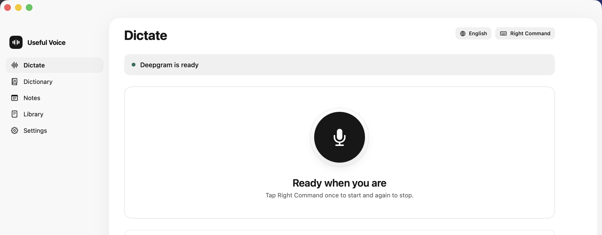
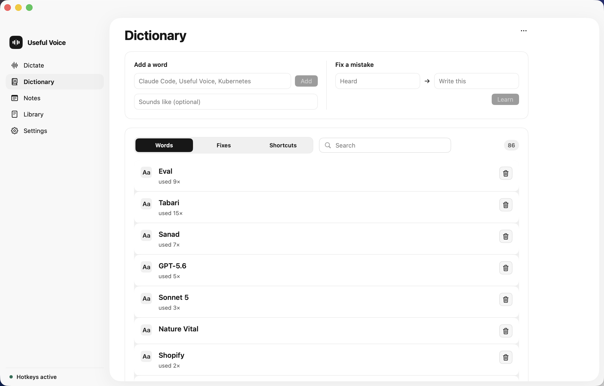
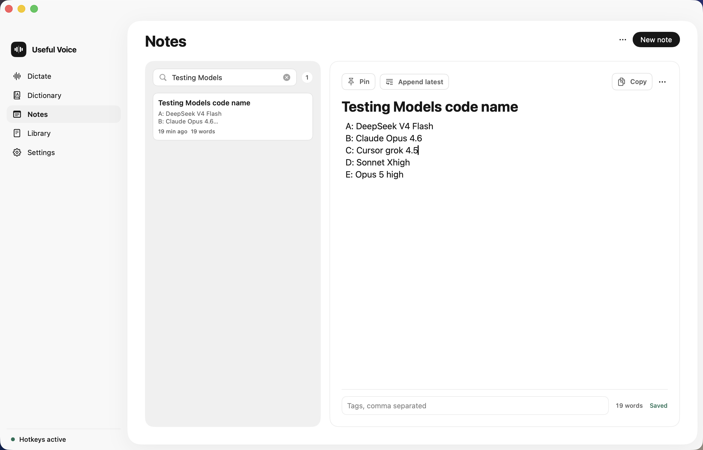
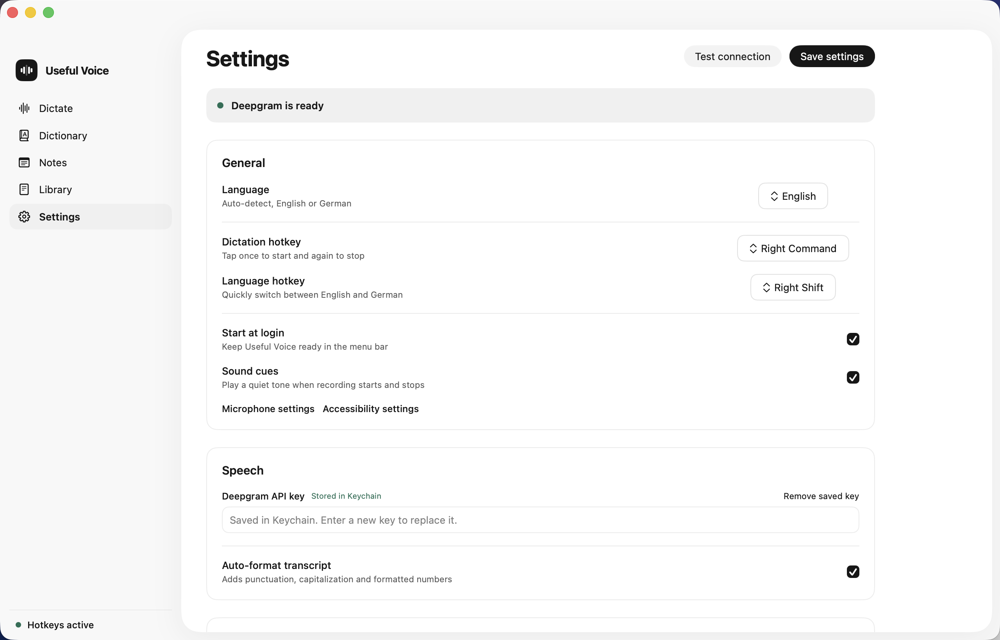

# Useful Voice

**Type with your voice, anywhere on your Mac.**

[](./LICENSE)
[](https://swift.org)


Useful Voice is a fast, personal dictation app for macOS and Windows. Tap a hotkey in any app, speak, and the text lands at your cursor. Pick your engine: Deepgram Nova-3 in the cloud, or a Whisper model that runs entirely on your Mac.



## What you get

**Dictate anywhere.** Tap your key (Right Command by default), speak, tap again. The text is inserted at your cursor and also copied to the clipboard, so a missed insert is one paste away. Esc cancels. Recording stops by itself after 60 seconds of silence.

**Teach it your words.** Add names and specialist spellings to your dictionary. They help recognition and fix casing on your Mac. Add a "sounds like" form and misheard variants are rewritten after transcription. Fix a recurring mistake once and it stays fixed.



**Keep what you said.** Notes are local and searchable, with pins, tags and Markdown copy. Your dictation history keeps every transcript, and Insights shows words, time saved and your streak.



**Your engine, your call.** Use Deepgram Nova-3 for fast cloud transcription. Or run Whisper large-v3-turbo (recommended) or large-v3 on your Mac, with no API key and no audio leaving your device. Both handle 99 languages with auto-detect.



## Before you install

| | |
|---|---|
| Works on | macOS 14 or later on Apple silicon. Windows 10 or later (see [windows/README.md](windows/README.md) for what's verified there) |
| Engines | Deepgram Nova-3 (cloud). On macOS also local Whisper large-v3-turbo and large-v3. The Windows app uses Deepgram |
| Stays on your device | Your dictionary, notes, history, settings and, on macOS, the last 10 recordings. Your Deepgram key sits in the macOS Keychain (Windows: encrypted with DPAPI). With a local Whisper model, your audio never leaves your Mac |
| Leaves your device | With Deepgram, each recording's audio and your dictionary's correct spellings go to Deepgram for transcription. Picking a local model downloads its weights from Hugging Face |
| Tracking | None. No analytics, no crash reports, no ads |
| Updates | Manual for now. The app doesn't check for updates yet |

## Install

Build it from source today. Clone this repository and run these in its folder. You need macOS 14 or later, Apple silicon and the Command Line Tools (full Xcode isn't needed).

```sh
make bundle                  # builds dist/UsefulVoice.app, ad-hoc signed
open dist/UsefulVoice.app
```

One-line installers and a downloadable app arrive with v1.0.0.

On first launch a short setup walks you through your engine, the microphone and Accessibility. Deepgram gives new accounts $200 in free credit, and setup links to the signup. You can run the setup again from Settings.

Windows builds from source too. See [windows/README.md](windows/README.md).

## Development

Everything below is for working on Useful Voice itself.

| Platform | Check |
|---|---|
| macOS | `make test` (Swift Testing suite) and `swift build` |
| Windows | `cd windows && npm run verify` (typecheck, vitest, build, Electron self-test) |
| Windows packaging | `cd windows && npx electron-builder --win --dir` |
| Windows E2E | `cd windows && env -u ELECTRON_RUN_AS_NODE npm run e2e` |

Use `make test`, not bare `swift test`. The Makefile adds the framework paths Swift Testing needs under the Command Line Tools.

The code is split in three:

- `Sources/UsefulVoiceCore` is the testable core: settings, providers, audio, the dictionary, language memory, history and the dictation pipeline.
- `Sources/UsefulVoiceApp` is the macOS app: menu bar, HUD, hotkey, text insertion and the pages.
- `windows/` is the Electron and TypeScript app. Its `src/core` mirrors the Swift core.

The design notes and audit reports are in [docs/audit](docs/audit), starting with [00-findings-and-fixes.md](docs/audit/00-findings-and-fixes.md). Release and source publishing are covered in [docs/distribution.md](docs/distribution.md).

## License

[MIT](LICENSE). Contributions are welcome as pull requests, and there's no CLA to sign.
